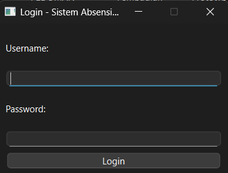
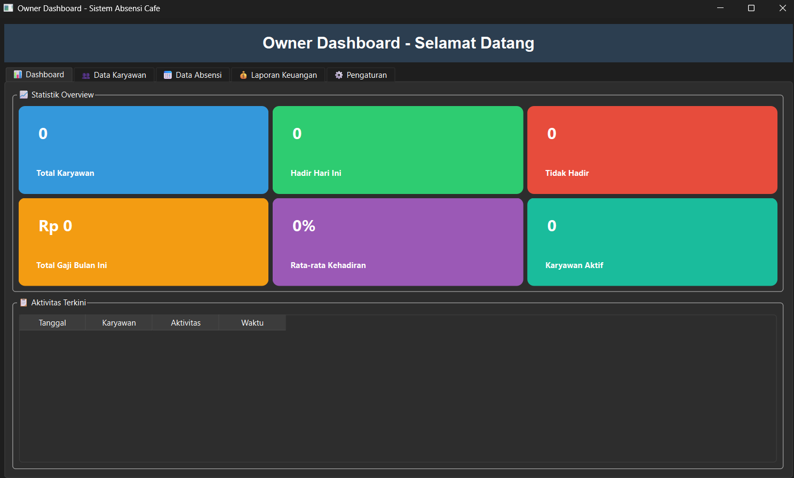
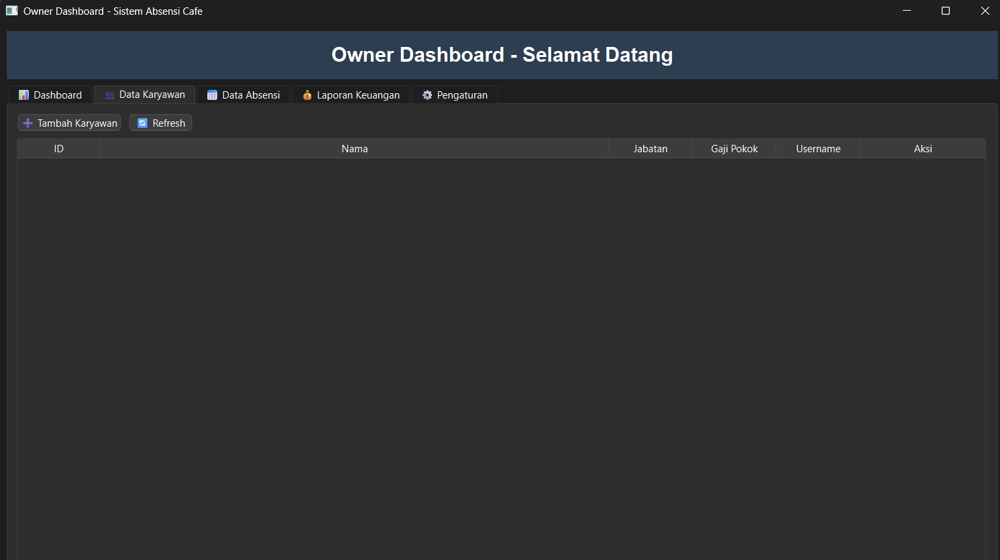
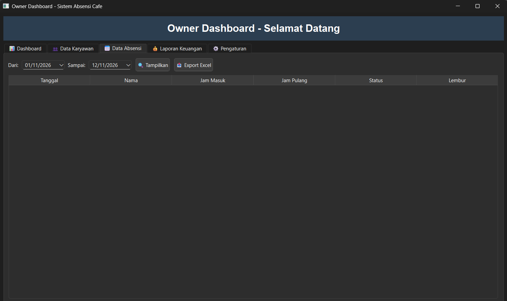
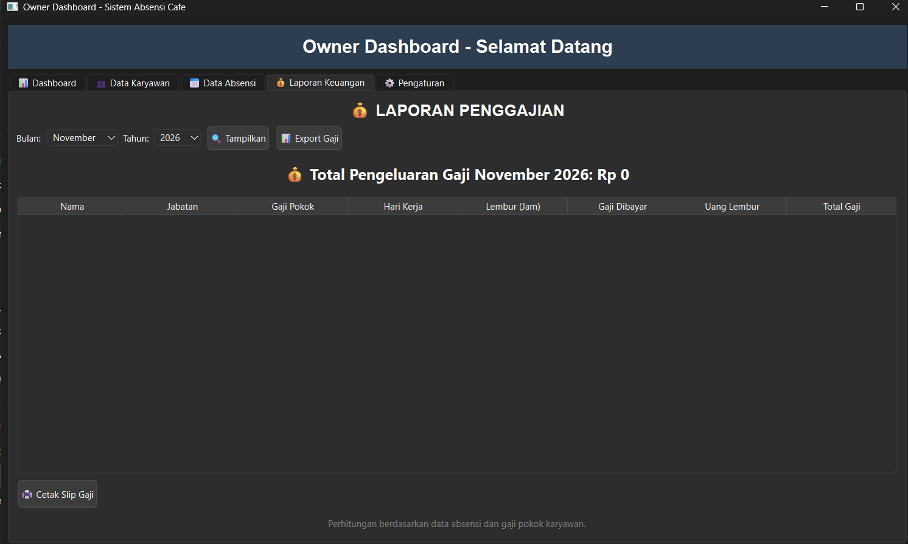
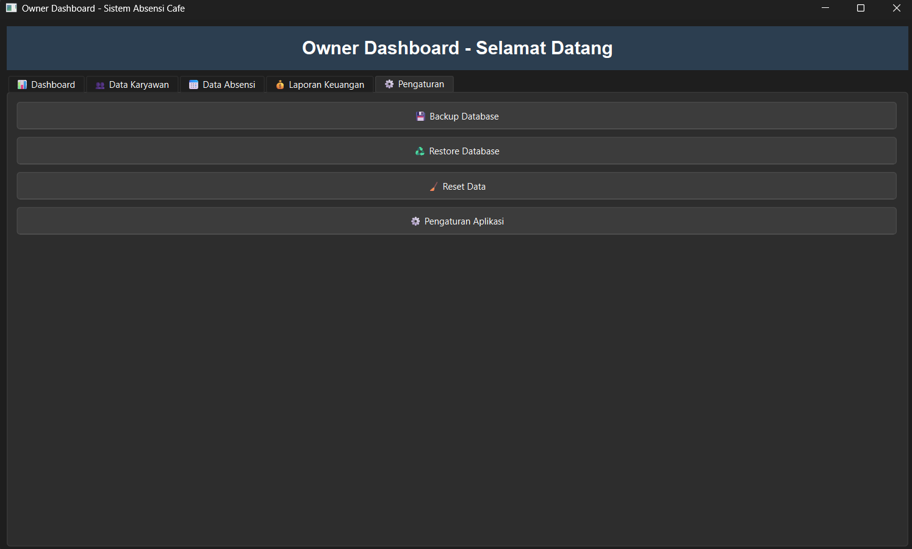

# Cafe Payroll & Attendance Management System

A desktop-based application for managing employee attendance and payroll in a cafe environment.

Developed using **Python, PyQt6, and SQLite**.

## Overview

Cafe Payroll & Attendance Management System is a desktop application designed to help cafe owners manage employee information, monitor attendance, and organize monthly payroll reports through a centralized interface.

## Features

- **User Authentication** – Login interface with username and password.
- **Owner Dashboard** – Overview of employee statistics and payroll information.
- **Employee Management** – Manage employee records.
- **Attendance Management** – Monitor attendance, working hours, and overtime.
- **Payroll Management** – Manage monthly salary reports.
- **Excel Export** – Export attendance and payroll reports.
- **Salary Slip Printing** – Generate and print salary slips.
- **Database Management** – Backup and restore database functionality.

## Screenshots

### Login


### Owner Dashboard


### Employee Management


### Attendance Management


### Payroll Management


### System Settings


## Tech Stack

- Python
- PyQt6
- SQLite
- OpenPyXL
- ReportLab
- Psutil

## Installation

1. Clone the repository:

```bash
git clone https://github.com/raflitryrizki/Sistem-Absensi-dan-Penggajian-Cafe.git
```

2. Install dependencies:

```bash
pip install -r requirements.txt
```

3. Run the application:

```bash
python main.py
```

## Developer

**Rafli Try Rizki**

GitHub: [@raflitryrizki](https://github.com/raflitryrizki)

## Project Status

Portfolio Project
